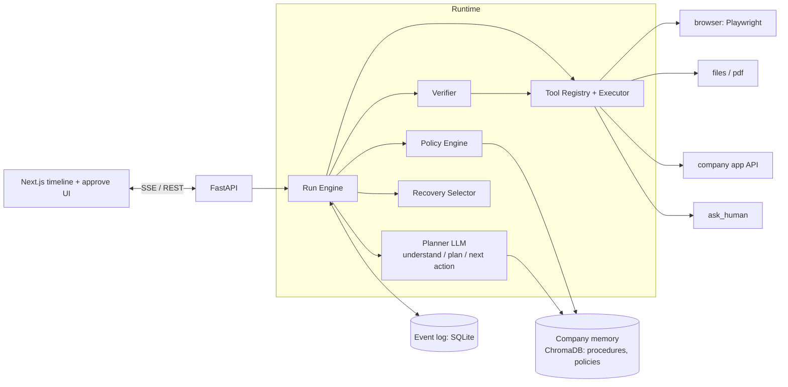

# Architecture: Autonomous Company Operator

## 1. Why this shape

Most agent demos are `while not done: llm(history) -> tool`. That fails the three
things an enterprise cares about:

| Failure | Cause | Our answer |
|---|---|---|
| "It said it was done but wasn't" | The agent grades itself | **Independent verifier** with read-only checks |
| "It did something it shouldn't have" | Safety lives in the prompt | **Policy engine in the runtime**, outside the LLM |
| "Why did it do that? Can we resume it?" | State is hidden in a context window | **Append-only event log**; state is a fold over events |

One principle ties these together: **the LLM proposes; a deterministic runtime
disposes.** The model produces a `TaskSpec`, a `Plan`, and `ToolCall`s. It never
executes anything, never decides if an action is permitted, and never decides
whether the job succeeded.

## 2. Components



| Component | Responsibility | Never does |
|---|---|---|
| **Run Engine** | Owns the loop. Reads state, asks the planner, routes through policy, executes, appends events | Call the LLM for permission or success decisions |
| **Planner (LLM)** | Compiles request to `TaskSpec`; proposes/revises `Plan`; picks next `ToolCall` | Execute tools, mark anything verified |
| **Policy Engine** | Maps `(tool risk, args, company rules, constraints)` to `allow / require_approval / deny` | Depend on prompt wording |
| **Tool Registry** | Typed tools with a risk tier; validates args against schema; handles timeout and retry | Hold task-specific logic |
| **Recovery Selector** | Maps `ErrorKind` to a strategy; enforces retry budget | Retry non-idempotent writes blindly |
| **Verifier** | Runs each criterion's `Check` with read tools; compares to expectation and recorded facts | Trust the acting agent's claim |
| **Event Log** | Single source of truth; every decision and observation | Mutate or delete events |

## 3. The core loop

```
Goal -> Understand -> Plan -> [ Decide -> Gate -> Execute -> Observe -> Adapt ]* -> Verify -> Complete
```

```python
def run(run_id):
    while True:
        state = fold(run_id, log.read(run_id))            # state is always derived
        if state.status in TERMINAL: return
        if state.pending_approval or state.pending_input: return   # park; resume on event

        if state.spec is None:      emit(TaskUnderstood(planner.understand(state)));  continue
        if state.spec.open_questions and not answered: emit(InputRequested(...));     continue
        if state.plan is None:      emit(PlanCreated(planner.plan(state)));           continue

        if plan_complete(state):    verify_and_finish(state);                         continue

        call = planner.next_action(state)                 # proposal only
        emit(ToolRequested(call))
        decision = policy.decide(call, state)             # deterministic
        emit(PolicyDecided(decision))
        if decision == "deny":              emit(RecoveryChosen(strategy="replan")); continue
        if decision == "require_approval":  emit(ApprovalRequested(...));            continue

        result = executor.run(call)                       # timeout, schema check, retries
        emit(ToolSucceeded(result) if result.ok else ToolFailed(result))
        if result.ok: extract_facts(result)               # -> FactRecorded with provenance
        else:         emit(RecoveryChosen(recovery.choose(result.error, state)))
```

Because every iteration begins with `fold(events)`, the process can crash or the
user can take hours to approve, and the run resumes exactly where it was.

## 4. Key mechanisms

### 4.1 Task compilation (the "understand" step)
A short request ("handle the Acme invoice") is expanded into a `TaskSpec` whose
`success_criteria` are **machine-checkable** (`Check` = read tool + args +
expectation). Context comes from company memory (e.g. "invoices go in the AP
module; amounts over 50,000 need approval"). Unstated assumptions are listed in
`assumptions` and shown to the user. Unresolvable ambiguity goes to
`open_questions`, which blocks execution and asks the human.

### 4.2 Policy (permissions and approvals)
| Risk tier | Default |
|---|---|
| `read` | allow |
| `write_reversible` | allow, logged |
| `write_irreversible` | require approval (unless a policy rule pre-authorises) |
| `external_comms` | require approval |

Rules are data (YAML or memory-backed) and can tighten on arguments, e.g.
`amount > 50000 -> require_approval`. Task `constraints` compile into `deny` rules.
Each decision records the `rule` that fired.

### 4.3 Recovery
| `ErrorKind` | Strategy | Notes |
|---|---|---|
| `transient` | retry with backoff | only if tool is `idempotent`, or `confirm_with` shows the write did not land |
| `not_found` | alternate tool / re-observe | e.g. element missing: re-snapshot DOM, try another locator |
| `invalid_input` | replan with the error | fix args |
| `state_mismatch` | replan | world changed vs. plan |
| `permission_denied` | ask human / abort | never route around a policy denial |
| `unknown` | one retry, then ask human | |

A per-call retry budget and a per-run step budget prevent loops. Exhausting
either escalates to a human rather than failing silently.

### 4.4 Facts and provenance
Every value the agent relies on (amount, due date, vendor) is a `Fact` with
`source_event_id`, an excerpt, and a confidence. Low confidence triggers
`ask_human` *before* an irreversible write. The verifier compares system state
to these facts, and the final report shows the source excerpt next to the result.

### 4.5 Verification
After the plan finishes, for each criterion the Verifier runs the `Check` with
a read tool against the *actual system* (e.g. reload the records page, query
the API) and emits `VerificationResult(expected, actual, evidence)`. The run is
`completed` only if all pass; otherwise the engine replans or escalates.
`ToolSpec.confirm_with` adds a cheap per-write check during execution.

**Known gap (state it in the README):** if extraction misreads the PDF, entered
value and expected fact agree and verification passes. Mitigations: confidence
threshold, showing the source excerpt for human sign-off, and a second
extraction pass for high-value fields.

## 5. Generalisation
Adding a task changes **data, not the loop**: a new request, new company
memory docs, and at most a new tool registered with a schema and risk tier. The
loop, policy engine, recovery selector, verifier, and event schema are task-agnostic.
Demonstrate this with two different tasks run through unchanged code.

## 6. Sample event trace (invoice task)

| seq | type | gist |
|---|---|---|
| 1 | `run.created` | "Find latest Acme invoice, enter amount and due date in AP, tell me when done" |
| 2 | `task.understood` | criterion c1: AP record for Acme has `amount == fact(invoice.amount)` and due date matches; assumption: "latest" = newest invoice date |
| 3 | `plan.created` | locate PDF, extract fields, open AP form, enter, submit, verify |
| 4-5 | `tool.requested` / `policy.decided` | `list_files` -> allow (read) |
| 6 | `tool.succeeded` | 3 Acme invoices found |
| 7-9 | read + extract | `fact.recorded` invoice.amount = 62,400 (source excerpt, conf 0.97) |
| 10 | `policy.decided` | `submit_form`: irreversible and amount > 50,000 -> **require_approval** |
| 11 | `approval.requested` | "About to submit AP record: Acme, 62,400, due 2026-10-28" |
| 12 | `approval.resolved` | approved by user |
| 13 | `tool.failed` | `transient`: form timeout (injected failure) |
| 14 | `recovery.chosen` | `confirm_with` shows no record -> safe to retry |
| 15 | `tool.succeeded` | attempt 2 submitted |
| 16 | `verification.result` | c1 passed: expected 62,400, actual 62,400 (screenshot attached) |
| 17 | `run.finished` | completed, summary + evidence |

## 7. Technical decisions to be ready to defend
- **Event sourcing over a mutable run row:** gives audit, resumability, replay for debugging and evals, and the UI timeline for free. Cost: a reducer to maintain.
- **Accessibility-tree snapshots over screenshots for the browser:** cheaper, more deterministic, directly verifiable. Screenshots are kept as evidence, with vision as a fallback.
- **Policy outside the LLM:** prompt-based safety is probabilistic; a runtime rule is not.
- **Facts with provenance:** turns "the model said so" into something a human can audit.
- **SQLite and in-process engine:** right for a prototype; the schema maps directly to Postgres plus a queue (see next steps).

## 8. Known limitations (draft)
Single-process engine; one worker per run; mock company app; no desktop-app control (browser and files only); policy rules hand-written; no learning from feedback yet; extraction-error gap above.

## 9. Next steps (draft)
Durable queue and worker pool with leases; per-tenant credential vault and sandboxed browser containers; desktop control via accessibility APIs or computer-use models; learning loop that distils approved/rejected runs into memory; an eval harness replaying logged runs against changed prompts or models; policy authoring UI.
